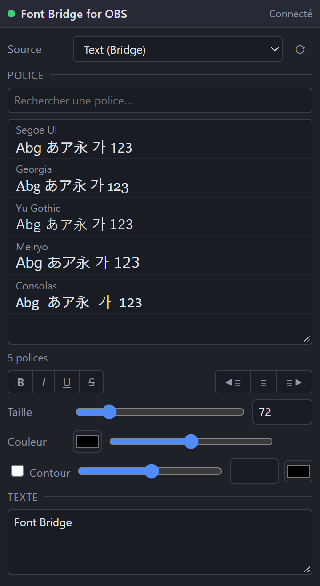

[English](README.md) | [日本語](README.ja.md) | [한국어](README.ko.md) | [Bahasa Indonesia](README.id.md) | **Français** | [繁體中文](README.zh-TW.md)

# Font Bridge for OBS

Un script qui permet à OBS de charger naturellement les polices qu'il ne pouvait pas afficher.

- Les polices activées dans un gestionnaire de polices sont chargées automatiquement (sans redémarrer OBS)
- Interface : English / 日本語 / 한국어 / Bahasa Indonesia / Français / 繁體中文 (autres langues d'OBS → English)
- Mode débogage : un dock de navigateur avec aperçu des polices

## Installation
1. Gardez `obs_font_bridge.lua` et `obs_font_bridge_dock.html` dans le même dossier.
2. OBS → **Outils → Scripts → +** → sélectionnez `obs_font_bridge.lua`.
3. **Sources → + → Texte (Bridge)**.

## Dock de débogage
1. Dans les réglages du script, cochez **Mode débogage** (les aperçus sont générés en arrière-plan).
2. Copiez l'**URL du dock**, puis **Docks → Docks de navigateur personnalisés…** → collez-la.
3. Activez **Outils → Paramètres du serveur WebSocket** et saisissez le même port / mot de passe dans les réglages du script.

## Désinstallation
Retirez le script dans **Outils → Scripts** (sélection, puis **−**), fermez OBS, puis lancez `Safe_Uninstaller.bat`. Il indique le rôle de chaque fichier, vous laisse choisir quoi supprimer, sauvegarde vos réglages, explique le passage à un autre PC et envoie le tout à la Corbeille.

Nécessite OBS 28+ (obs-websocket v5 intégré) sous Windows.

Auteur : ChromeBread feat. BlackDream ・ Licence : GPL-2.0

Ce script tiers n'est pas officiel. Il n'est ni affilié au projet OBS ni approuvé par celui-ci.
