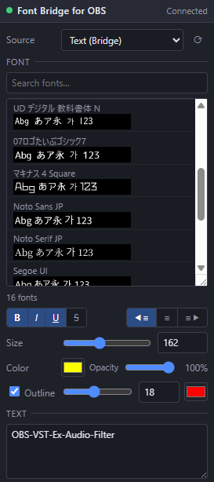

[English](README.md) | [日本語](README.ja.md) | [한국어](README.ko.md) | **Bahasa Indonesia** | [Français](README.fr.md) | [繁體中文](README.zh-TW.md)

# Font Bridge for OBS

Skrip yang membuat OBS dapat memuat secara alami font yang sebelumnya tidak bisa ditampilkan.

- Font yang diaktifkan di pengelola font dimuat otomatis (tanpa memulai ulang OBS)
- UI: English / 日本語 / 한국어 / Bahasa Indonesia / Français / 繁體中文 (bahasa OBS lain → English)

## Instalasi
1. Letakkan seluruh folder `Font_Bridge_for_OBS` di `%APPDATA%\obs-studio\plugin_config\` (tempel jalur ini di bilah alamat Explorer untuk membukanya).
2. OBS → **Alat → Skrip → +** → pilih `obs_font_bridge.lua`.
3. **Sumber → + → Teks (Bridge)**.

## Mode Debug
Coba centang **Mode Debug** di pengaturan skrip. Ada sedikit bonus di dalamnya.

## Hapus instalasi
Hapus skrip dari **Alat → Skrip** (pilih, tekan **−**), tutup OBS, lalu jalankan `Safe_Uninstaller.bat`. Alat ini menampilkan fungsi tiap file, memungkinkan Anda memilih yang dihapus, mencadangkan pengaturan, menjelaskan cara pindah ke PC lain, dan memindahkan semuanya ke Recycle Bin.

Memerlukan OBS 28+ (obs-websocket v5 bawaan) di Windows.

Pembuat: ChromeBread feat. BlackDream ・ Lisensi: GPL-2.0

Ini adalah skrip pihak ketiga tidak resmi. Tidak berafiliasi dengan atau didukung oleh OBS Project.

## Tentang pembaruan

Perangkat lunak ini tidak memeriksa pembaruan atau memperbarui dirinya sendiri, dan tidak ada rencana menambahkan fitur pembaruan otomatis yang terhubung ke internet. Untuk memperbarui, ikuti tautan pengembang dan unduh versi baru sendiri dari situs distribusi: [Releases](../../releases)
