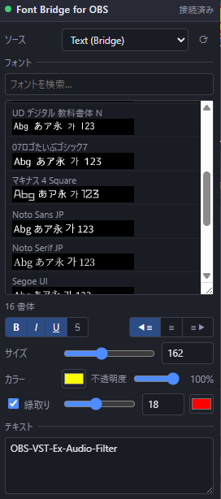

[English](README.md) | **日本語** | [한국어](README.ko.md) | [Bahasa Indonesia](README.id.md) | [Français](README.fr.md) | [繁體中文](README.zh-TW.md)

# Font Bridge for OBS

OBS で反映できなかったフォントを、自然の力で正しく読み込めるようにするスクリプトです。

## インストール
1. `obs_font_bridge.lua` と `obs_font_bridge_dock.html` を同じフォルダに置きます。
2. OBS → **ツール → スクリプト → +** で `obs_font_bridge.lua` を選びます。
3. **ソース → + → テキスト (Bridge)** を追加します。

## デバッグドック
1. スクリプトの設定で **デバッグモード** にチェックを入れます (プレビューはバックグラウンドで生成されます)。
2. **ドックURL** をコピーし、**ドック → カスタムブラウザドック…** に貼り付けます。
3. **ツール → WebSocketサーバー設定** を有効にし、同じポートとパスワードをスクリプトの設定に入力します。

## アンインストール
**ツール → スクリプト** でスクリプトを外し (選択して **−**)、OBS を閉じてから `Safe_Uninstaller.bat` を実行します。各ファイルの内容を表示し、削除するものを選べます。設定のバックアップ、別の PC への引っ越し手順の表示にも対応し、削除したものはごみ箱へ移動します。

Windows の OBS 28 以降 (obs-websocket v5 内蔵) が必要です。

製作者: ChromeBread feat. BlackDream ・ ライセンス: GPL-2.0

これは非公式のサードパーティ製スクリプトです。OBS Project とは関係がなく、承認も受けていません。
