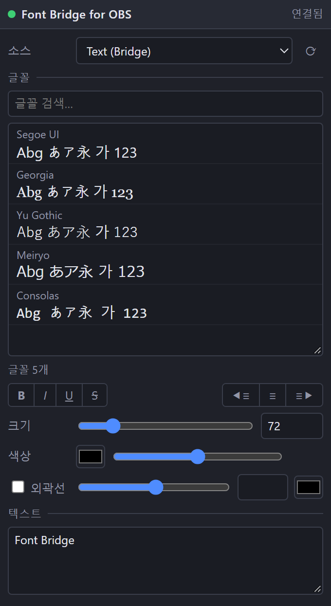

[English](README.md) | [日本語](README.ja.md) | **한국어** | [Bahasa Indonesia](README.id.md) | [Français](README.fr.md) | [繁體中文](README.zh-TW.md)

# Font Bridge for OBS

OBS에서 표시하지 못했던 글꼴을 자연스럽게 올바로 불러올 수 있게 해 주는 스크립트입니다.

- 글꼴 관리 프로그램에서 켠 글꼴도 자동으로 불러옵니다 (OBS 재시작 불필요)
- UI: English / 日本語 / 한국어 / Bahasa Indonesia / Français / 繁體中文 (다른 OBS 언어는 영어)
- 디버그 모드: 글꼴 미리보기가 있는 브라우저 도크

## 설치
1. `obs_font_bridge.lua`와 `obs_font_bridge_dock.html`을 같은 폴더에 둡니다.
2. OBS → **도구 → 스크립트 → +** 에서 `obs_font_bridge.lua`를 선택합니다.
3. **소스 → + → 텍스트 (Bridge)** 를 추가합니다.

## 디버그 도크
1. 스크립트 설정에서 **디버그 모드**를 체크합니다 (미리보기는 백그라운드에서 생성됩니다).
2. **도크 URL**을 복사해 **도크 → 사용자 지정 브라우저 도크…** 에 붙여넣습니다.
3. **도구 → WebSocket 서버 설정**을 켜고 같은 포트와 비밀번호를 스크립트 설정에 입력합니다.

## 제거
**도구 → 스크립트**에서 스크립트를 뺀 뒤 (선택하고 **−**) OBS를 닫고 `Safe_Uninstaller.bat`을 실행합니다. 각 파일의 내용을 보여 주고 제거할 항목을 고를 수 있습니다. 설정 백업과 다른 PC로 옮기는 방법도 제공하며, 제거한 항목은 휴지통으로 이동합니다.

Windows용 OBS 28 이상 (obs-websocket v5 내장)이 필요합니다.

제작자: ChromeBread feat. BlackDream ・ 라이선스: GPL-2.0

비공식 서드파티 스크립트입니다. OBS Project와 관련이 없으며 승인을 받지 않았습니다.
