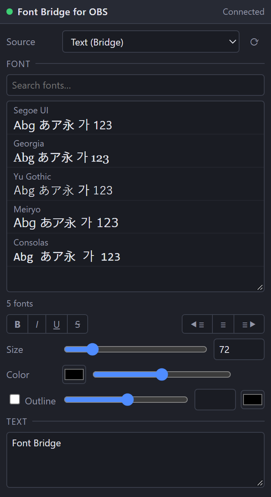

**English** | [日本語](README.ja.md) | [한국어](README.ko.md) | [Bahasa Indonesia](README.id.md) | [Français](README.fr.md) | [繁體中文](README.zh-TW.md)

# Font Bridge for OBS

A script that lets OBS Studio (Windows) naturally load the fonts it couldn't display before.

- Fonts newly activated in a font manager are picked up automatically (no OBS restart)
- UI in English / 日本語 / 한국어 / Bahasa Indonesia / Français / 繁體中文 (other OBS languages → English)
- Debug Mode: a browser dock with font previews

## Install
1. Keep `obs_font_bridge.lua` and `obs_font_bridge_dock.html` in the same folder.
2. OBS → **Tools → Scripts → +** → select `obs_font_bridge.lua`.
3. **Sources → + → Text (Bridge)**.

## Debug dock
1. In the script settings, tick **Debug Mode** (previews are generated in the background).
2. Copy the **Dock URL**, then **Docks → Custom Browser Docks…** → paste it.
3. Enable **Tools → WebSocket Server Settings** and enter the same port / password in the script settings.

## Uninstall
Remove the script from **Tools → Scripts** (select it, press **−**), close OBS, then run `Safe_Uninstaller.bat`. It shows what each file is, lets you choose what to remove, backs up your settings, explains moving to another PC, and sends everything to the Recycle Bin.

Requires OBS 28+ (built-in obs-websocket v5) on Windows.

Author: ChromeBread feat. BlackDream ・ License: GPL-2.0

This is an unofficial third-party script. It is not affiliated with or endorsed by the OBS Project.

## Updates

This software does not check for updates or update itself, and no automatic update feature that connects to the internet is planned. To update, follow the developer's link and download the new version from the distribution site yourself: [Releases](../../releases)
