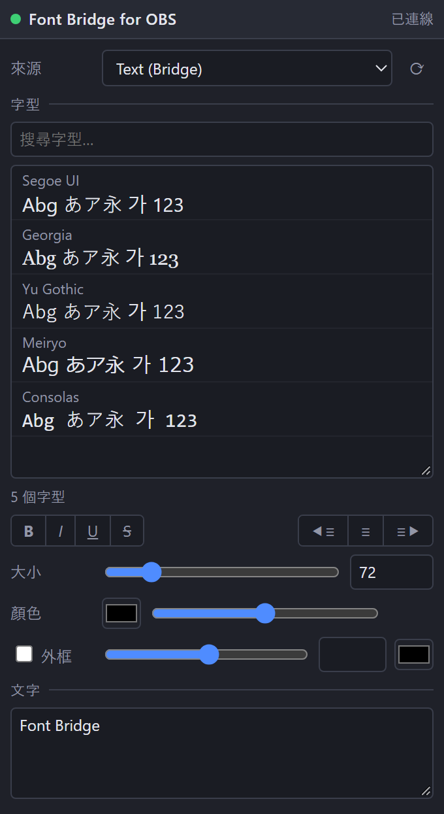

[English](README.md) | [日本語](README.ja.md) | [한국어](README.ko.md) | [Bahasa Indonesia](README.id.md) | [Français](README.fr.md) | **繁體中文**

# Font Bridge for OBS

讓 OBS 能自然地正確讀取原本無法顯示的字型的腳本。

- 以字型管理工具啟用的字型會自動載入 (不需重新啟動 OBS)
- 介面語言：English / 日本語 / 한국어 / Bahasa Indonesia / Français / 繁體中文 (其他 OBS 語言 → English)
- 偵錯模式：附字型預覽的瀏覽器停駐視窗

## 安裝
1. 將 `obs_font_bridge.lua` 與 `obs_font_bridge_dock.html` 放在同一資料夾。
2. OBS → **工具 → 腳本 → +** → 選擇 `obs_font_bridge.lua`。
3. **來源 → + → 文字 (Bridge)**。

## 偵錯停駐視窗
1. 在腳本設定中勾選 **偵錯模式** (預覽會在背景產生)。
2. 複製 **Dock 網址**，然後在 **停駐視窗 → 自訂瀏覽器停駐視窗…** 貼上。
3. 啟用 **工具 → WebSocket 伺服器設定**，並在腳本設定中輸入相同的連接埠與密碼。

## 解除安裝
在 **工具 → 腳本** 移除腳本 (選取後按 **−**)，關閉 OBS，再執行 `Safe_Uninstaller.bat`。它會顯示每個檔案的用途，可選擇要移除的項目、備份設定、說明如何搬移到其他電腦，並將項目移到資源回收筒。

需要 Windows 版 OBS 28 以上 (內建 obs-websocket v5)。

製作者: ChromeBread feat. BlackDream ・ 授權: GPL-2.0

這是非官方的第三方腳本，與 OBS Project 無關，也未獲其認可。

## 關於更新

本軟體沒有檢查更新或自動更新的功能，今後也沒有實作連網自動更新功能的計畫。需要更新時，請依開發者的連結自行前往發布網站下載: [Releases](../../releases)
